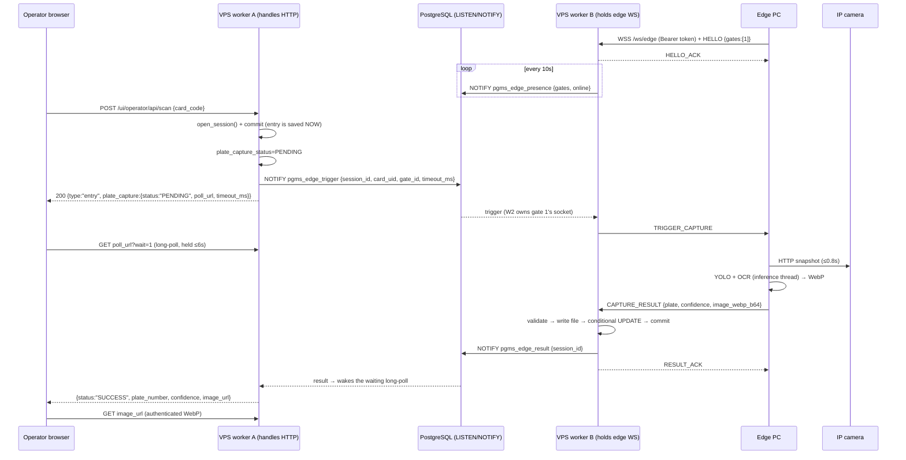

# Edge Plate Capture — Implementation Handoff

> **Audience:** an AI/engineer continuing this work with no prior context.
> **Status (2026-10-19):** code complete and tested locally. **NOT deployed** (migration not run, service not restarted) and **NOT committed** to git.
> **Project root:** `/srv/pgms-babelooq/app` (FastAPI + Jinja2 + SQLAlchemy async, PostgreSQL in production). Live at `https://babelooq.garage4u.io`, operator screen `/ui/operator/dashboard`.

---

## 1. Goal

When an entry operator scans a parking card, the system must also:

1. Tell a PC inside the garage (the "edge PC") to take a snapshot from a local IP camera.
2. Run YOLO + OCR there to read the licence plate.
3. Send the plate text plus a WebP image back to the VPS.
4. Store both with the parking session and show them on the operator's screen. Target latency is under 1.5 s.

Before this work, the scan already created the session correctly. Nothing about cameras or plates existed.

## 2. Network constraints (why the design looks like this)

| Machine | Network | Reachable from outside? |
|---|---|---|
| VPS | Public IP, Nginx → Gunicorn → FastAPI, domain + TLS | Yes |
| Operator PC (gate) | 4G USB modem behind CGNAT. Runs the dashboard in a browser plus a card scanner (keyboard wedge) | No |
| Edge PC (garage) | Garage LAN router. The IP camera is on the same LAN. Holds the YOLO + OCR models | No |

Neither the operator PC nor the edge PC can be reached directly, so **the VPS is the broker**. Both machines make outbound connections to it:

- The edge PC holds a **persistent outbound WebSocket** to the VPS.
- The operator browser uses ordinary HTTP: the scan POST, then an **XHR long-poll** for the result.

### Deployment facts discovered (they drove key decisions)

- systemd unit `/etc/systemd/system/pgms-babelooq.service` runs **Gunicorn with 3 `UvicornWorker` processes** on `127.0.0.1:8003`. Settings: `ProtectSystem=strict`, `ReadWritePaths=/srv/pgms-babelooq/app /var/log/pgms-babelooq`.
- Nginx site `/etc/nginx/sites-enabled/pgms-babelooq`:
  - `location /` already forwards `Upgrade` / `Connection "upgrade"` with `proxy_read_timeout 120s`, so WebSockets work with no Nginx change.
  - `location /api/` has `limit_req`. The edge socket is deliberately at `/ws/edge` to stay out of that block.
- **No Redis** on the box. **PostgreSQL** is the production DB (`postgresql+asyncpg://…/pgms_babelooq_db`).
- The frontend JS is written to be **ES5 / IE11-compatible**: XHR only, no arrow functions, no `let`/`const`. That rules out depending on `EventSource` (SSE).

## 3. Architecture



### Key design decisions and rationale

1. **The entry is never blocked by the camera.**
   - The session is committed and the operator sees "تم تسجيل الدخول" immediately. The plate and image fill in afterwards.
   - Camera, model or 4G failures therefore cannot stop the gate.
   - *The user has been told and may want this changed.* To make the gate wait for the plate, change only the frontend: delay the success state until `finishCapture()`.
2. **Cross-worker messaging uses PostgreSQL `LISTEN/NOTIFY`.**
   - With 3 workers, the edge socket lives in one process while the scan or long-poll can land in any process. A purely in-memory broker would silently lose about 2/3 of triggers.
   - Postgres was already there, so no new infrastructure is needed.
   - Only tiny JSON envelopes go through NOTIFY (8000-byte limit; we cap at 7900). **Images never do.**
3. **Images go to disk and the path goes to the DB.**
   - Location: `media/plates/YYYY/MM/DD/<session_id>_<rand>.webp`, relative to the app dir. Writes are atomic (tmp file + `os.replace`).
   - Images are served only through an authenticated route, never as public static files.
4. **The operator gets results by long-poll, not SSE or WebSocket.**
   - Works with the existing ES5/XHR code.
   - Releases the DB connection while waiting.
   - Wakes instantly through an in-process `asyncio.Event` set by the result notification.
   - Re-reads the DB every 1 s as a safety net in case a notification is lost while the listener reconnects.
5. **Presence.**
   - Each worker broadcasts heartbeats (every 10 s) for the gates whose sockets it holds. Every worker builds a cluster-wide view from these, with a 30 s TTL.
   - If the gate is known to be offline, the scan returns `OFFLINE` immediately instead of waiting out the timeout.
   - A worker younger than the TTL answers "unknown" and dispatches anyway.
   - Each heartbeat carries a `conn_id`, so a late "offline" message from an old socket cannot override a newer reconnection that landed on another worker.
6. **Relative time budget.**
   - The trigger carries `timeout_ms`, not an absolute deadline, so clock skew between the VPS and the edge PC doesn't matter.
   - The edge **skips the snapshot** if the budget already ran out while waiting behind another capture. Otherwise it would photograph the *next* car.
7. **Late results are still stored.**
   - A result for a session in `PENDING` **or** `TIMEOUT` is accepted. The operator view has moved on, but the record gets the plate and image.
   - Final states (`SUCCESS` / `NO_PLATE` / `FAILED` / `OFFLINE`) reject duplicates.
8. **An operator-typed plate is never overwritten.** The OCR plate is written to `parking_sessions.plate_number` only if it is NULL. That makes it appear automatically on the exit screen and in reports.
9. **Security.**
   - The edge authenticates with `Authorization: Bearer <EDGE_API_TOKEN>`, compared with `hmac.compare_digest`. The endpoint is **disabled** when the token is unset.
   - An edge may only write results for sessions whose `gate_number` is in its HELLO `gates`.
   - Images must decode as base64, be ≤ `PLATE_IMAGE_MAX_BYTES`, and carry WebP magic bytes (`RIFF....WEBP`).
   - Image path resolution refuses anything outside `PLATE_IMAGE_DIR`.
   - Operators can only view their own sessions' capture and image. Admins can view all.
10. **Feature flag by configuration.** When `EDGE_API_TOKEN` is unset, the scan response has `plate_capture: null` and the dashboard behaves exactly as before. Deploying the code before the edge PC is ready is therefore safe.

## 4. WebSocket protocol (`wss://babelooq.garage4u.io/ws/edge`)

Schemas are in `schemas/edge.py` (Pydantic v2). All frames are JSON text.

| Direction | event | Fields |
|---|---|---|
| Edge → VPS | `HELLO` (first frame, within 5 s, or the socket closes with 1008) | `node_id` (str ≤64), `gates` (list[int] ≥1, 1–16 items, deduped and sorted), `version` |
| VPS → Edge | `HELLO_ACK` | `conn_id` |
| VPS → Edge | `TRIGGER_CAPTURE` | `session_id`, `card_uid`, `gate_id`, `timeout_ms` (= server timeout − 500 ms margin, min 300) |
| Edge → VPS | `CAPTURE_RESULT` | `session_id`, `status` ∈ `SUCCESS`/`NO_PLATE`/`ERROR`, `plate_number?`, `confidence?` (0–1), `image_webp_b64?`, `error?` (≤255), `timings_ms?` |
| VPS → Edge | `RESULT_ACK` | `session_id`, `accepted` (bool), `reason` (str or null) |
| Edge → VPS / VPS → Edge | `PING` / `PONG` | optional app-level ping. Protocol-level pings run every 20 s on both sides anyway |

Notes:
- An auth failure closes the socket before `accept()`, so the client sees HTTP 403 on the handshake.
- A new connection claiming a gate replaces the previous socket for that gate on the same worker (close code 4000).

Status mapping on the server: `SUCCESS → SUCCESS` (downgraded to `NO_PLATE` if the plate normalises to empty), `NO_PLATE → NO_PLATE`, `ERROR → FAILED`.

## 5. Database changes

Migration: `alembic/versions/b8e4d2c71f05_add_plate_capture_columns.py` (revises `7f2e1a9d4b83`, the previous head). It adds the following nullable columns to `parking_sessions`:

| Column | Type | Meaning |
|---|---|---|
| `plate_capture_status` | String(16) | `PENDING`, `SUCCESS`, `NO_PLATE`, `FAILED`, `TIMEOUT`, `OFFLINE`. NULL = no capture attempted. Plain string, not a DB enum, so new states need no migration |
| `plate_capture_requested_at` | DateTime (naive UTC, like the rest of the code) | when the trigger was dispatched; the deadline is computed from it |
| `plate_captured_at` | DateTime | when the result was stored |
| `plate_confidence` | Float | detector confidence × OCR confidence |
| `plate_image_path` | String(255) | path relative to `PLATE_IMAGE_DIR` |
| `plate_capture_error` | String(255) | reason for FAILED/TIMEOUT/OFFLINE |

The Python enum `PlateCaptureStatus(str, Enum)` lives in `models/parking_session.py`.

## 6. HTTP endpoints

| Method / path | Auth | Description |
|---|---|---|
| `POST /ui/operator/api/scan` (existing) | operator cookie `pgms_token` | Entry branch (`gate_number == 1`) now also starts the capture. The response gains `plate_capture: {status, poll_url, timeout_ms}` or `null` when disabled or failed to start |
| `GET /ui/operator/api/sessions/{id}/plate[?wait=1]` | operator (own sessions) / admin | Returns `{success, session_id, status, plate_number, confidence, image_url, error}`. With `wait=1`, holds the request until status ≠ PENDING, the deadline passes (it then marks `TIMEOUT`), or `PLATE_POLL_MAX_WAIT_S` elapses |
| `GET /ui/operator/api/sessions/{id}/plate-image` | operator (own) / admin | `image/webp`, `Cache-Control: private, max-age=86400`; 404 if missing |
| `WS /ws/edge` | Bearer `EDGE_API_TOKEN` | Edge socket (section 4) |

Note: the user's original spec mentioned `POST /api/operator/scan` with `card_uid` / `gate_id`. I deliberately **reused the existing** `/ui/operator/api/scan` (`card_code`). The gate comes from the operator's active shift (`session.gate_number`), and `card_uid` in the trigger is `session.card_code`.

## 7. Configuration

### VPS (`config.py`, read from `.env`; documented in `.env.example`)

| Variable | Default | Notes |
|---|---|---|
| `EDGE_API_TOKEN` | unset (= feature off) | ≥32 chars, validated. Generate with `openssl rand -hex 32` |
| `PLATE_CAPTURE_TIMEOUT_S` | 4.0 | hard server deadline, validated to 0.5–30. Target is about 1.5 s; 4 s allows for 4G jitter |
| `PLATE_POLL_MAX_WAIT_S` | 6.0 | max hold of one long-poll request |
| `EDGE_PRESENCE_TTL_S` | 30 | must exceed 2 × heartbeat (10 s); enforced in `EdgeHub.__init__` |
| `PLATE_IMAGE_DIR` | `media/plates` | relative to the app dir. `media/` is already in `.gitignore` |
| `PLATE_IMAGE_MAX_BYTES` | 1500000 | |

### Edge PC (`edge_agent/settings.py`, env prefix `EDGE_`, file `edge_agent/.env`; template `edge_agent/.env.example`)

`EDGE_SERVER_URL`, `EDGE_API_TOKEN` (must equal the VPS value), `EDGE_NODE_ID`, `EDGE_CAMERAS` (JSON map gate → snapshot URL, e.g. `{"1": "http://192.168.1.64/ISAPI/Streaming/channels/101/picture"}`), `EDGE_CAMERA_AUTH` (`none` / `basic` / `digest`), `EDGE_CAMERA_USERNAME`, `EDGE_CAMERA_PASSWORD`, `EDGE_SNAPSHOT_TIMEOUT_S` (0.8), `EDGE_DETECTOR_WEIGHTS`, `EDGE_OCR_LANGS` (`["ar"]`), `EDGE_USE_GPU`, `EDGE_MIN_DETECTION_CONFIDENCE` (0.35), `EDGE_WEBP_QUALITY` (70), `EDGE_WEBP_MAX_WIDTH` (1024), `EDGE_LOG_LEVEL`.

## 8. Timeout budget (end to end)

| Stage | Limit | Where |
|---|---|---|
| Edge handshake (HELLO) | 5 s | `routes/edge_ws.py` `_HELLO_TIMEOUT_S` |
| VPS → edge send | 2 s | `EdgeConnection.send_json` |
| Edge budget per trigger | `PLATE_CAPTURE_TIMEOUT_S − 0.5 s` (min 0.3 s) | `plate_capture_service._EDGE_NETWORK_MARGIN_MS` |
| Skip capture if budget left ≤ 50 ms | — | `EdgeAgent._capture` |
| Camera snapshot | min(0.8 s, remaining budget); connect ≤0.5 s | `SnapshotCamera` |
| Server hard deadline | 4.0 s → `TIMEOUT` | `PlateCaptureService.get_fresh` |
| Long-poll hold | ≤6 s, DB re-check every 1 s, +0.25 s past the deadline to mark TIMEOUT | `api_plate_capture_status` |
| Browser gives up | `timeout_ms` + 3 s; XHR timeout 12 s; retry every 500 ms on network error | `dashboard.js` |
| Edge result send | 5 s, otherwise queued in the outbox (max 50 items, 120 s age) and flushed after reconnect | `EdgeAgent` |
| WS keepalive | ping every 20 s on both sides (Nginx read timeout is 120 s) | uvicorn default / `connect(ping_interval=20)` |
| Edge reconnect | exponential backoff 1 → 30 s with jitter | `EdgeAgent.run_forever` |
| Event-bus listener | health check every 15 s, reconnect 0.5 → 10 s backoff | `PostgresEventBus` |

## 9. Files

### New
| File | Purpose |
|---|---|
| `services/event_bus.py` | `EventBus` ABC, `PostgresEventBus` (asyncpg listener on a dedicated connection; publishes via `SELECT pg_notify()` through the SQLAlchemy pool), `LocalEventBus` (in-process, for SQLite dev/tests), `create_event_bus(url, engine)` |
| `services/edge_hub.py` | `EdgeHub`: per-worker socket registry, cluster presence, trigger forwarding, `result_waiter()` context manager (register **before** reading the DB to avoid the race). `EdgeConnection` serialises sends with a lock. Channels: `pgms_edge_trigger`, `pgms_edge_result`, `pgms_edge_presence` |
| `services/plate_capture_service.py` | `PlateCaptureService.start / record_result / get_fresh / remaining_s / resolve_image`, `CaptureRejected`, `capture_payload()` (JSON shape the dashboard consumes) |
| `routes/edge_ws.py` | `/ws/edge` endpoint, auth, HELLO, message loop, result → DB → NOTIFY → ACK |
| `schemas/edge.py` | `EdgeHello`, `CaptureResult`, `TriggerCapture` |
| `alembic/versions/b8e4d2c71f05_add_plate_capture_columns.py` | migration |
| `edge_agent/agent.py` | `EdgeAgent` (connect loop, handshake, trigger tasks, per-gate locks, single-thread inference executor, outbox), `main()`. Run with `python -m edge_agent.agent` from the folder that contains `edge_agent/` |
| `edge_agent/camera.py` | `SnapshotCamera` (pooled `httpx.AsyncClient`, basic/digest auth, `CameraError`) |
| `edge_agent/recognizer.py` | `PlateRecognizer` protocol, `Recognition` dataclass, `YoloOcrRecognizer` (Ultralytics YOLO detection + EasyOCR on the crop, Egyptian layout assembly: letters right, digits left → `"ب ن ر 1234"`), `decode_image`, `encode_webp` |
| `edge_agent/settings.py` | `EdgeSettings` (pydantic-settings) |
| `edge_agent/requirements.txt`, `edge_agent/.env.example`, `edge_agent/__init__.py` | |
| `tests/integration/test_edge_plate_capture.py` | 5 end-to-end tests (see section 10) |
| `tests/unit/test_edge_hub.py` | 4 presence/waiter unit tests |
| `docs/edge-plate-capture.md` | this file |

### Modified
| File | Change |
|---|---|
| `config.py` | 6 new settings plus validation |
| `models/parking_session.py` | `PlateCaptureStatus` enum and 6 columns; `Float` import |
| `main.py` | lifespan step 3 creates the bus and `EdgeHub`, stores it as `app.state.edge_hub`, starts/stops both; includes `edge_ws_router` |
| `routes/ui_operator.py` | imports, `logger`; `_start_plate_capture()` and `_can_view_session()`; the scan endpoint gets a `settings=Depends(get_settings)` parameter and returns `plate_capture`; two new endpoints appended at the end of the file |
| `templates/operator/dashboard.html` | new `#entry-capture-box` (`` max-height 150px plus `#entry-capture-status`) inside `#entry-display-box`; script cache-buster bumped to `dashboard.js?v=20261019a` |
| `static/js/dashboard.js` | ES5 functions `startPlateCapture`, `pollPlateCapture`, `finishCapture`, `renderCapture`, `scheduleEntryReset`; `captureToken` counter discards stale replies after reset or a new scan. The entry screen's 4 s auto-reset now starts **after** the capture resolves. For subscribers with a registered plate, the camera plate is shown in the status line instead of replacing it |
| `static/sw.js` | `CACHE_NAME` → `garage4u-v2`. Any path containing `/api/` is now network-only. Previously `/ui/operator/api/*` (long-polls and car images) fell into "UI pages: network-first + cache", which would have filled browser cache storage with car photos |
| `.env.example` | documents the new VPS variables |
| `.gitignore` | added `edge_agent/.env` on its own line (the file has a pre-existing stray PowerShell line `"@ \| Out-File …` with no trailing newline; left as is) |

Pre-existing uncommitted user edits in `dashboard.html` / `dashboard.js` (styling, 10 s refresh) were already present and were preserved. `test_temp.db-journal` shows as deleted in git: it is a tracked test artifact removed by the test run, not part of this work.

## 10. Verification performed

1. **New tests: 9/9 pass.** Run them with `.venv/bin/python -m pytest tests/integration/test_edge_plate_capture.py tests/unit/test_edge_hub.py`.
   - The integration tests use a **dedicated mini FastAPI app** (in-memory SQLite + `LocalEventBus`) with Starlette `TestClient` and a real WebSocket. **Do not use `main.app` with lifespan in tests**: its lifespan connects to the production Postgres from `.env` and runs subscription-expiry writes.
   - The integration tests cover:
     - the full flow, with the long-poll woken by the result in under 1 s and the image served;
     - a duplicate result being rejected;
     - timeout followed by a late result that is still stored;
     - `OFFLINE` returned immediately when no edge is connected;
     - a gate-2 edge being unable to write to a gate-1 session;
     - a non-WebP image being rejected with no file left behind;
     - a bad token being rejected.
2. **Full suite:** 337 passed, 24 failed. Before the change it was 328 passed with **the identical 24 failures**, which are pre-existing and unrelated (subscriptions, reports, a `name 'date' is not defined` error, etc.).
3. **Live smoke test** (scripts in the session scratchpad, not in the repo):
   - Setup: real uvicorn server, the real `EdgeAgent` over a real WebSocket, a fake HTTP camera (1920×1080 JPEG, 120 ms latency) and a stub recognizer (150 ms).
   - End-to-end time from scan to result: **375–630 ms**.
   - Killing and restarting the server: the agent reconnected by itself (backoff 0.7 s → 1.4 s) and the next capture succeeded.
4. **`PostgresEventBus` against the real production Postgres**, using two bus instances standing in for two workers on a throwaway channel (NOTIFY only, no data written): delivered in **~30 ms**, and an oversize payload was rejected.

### Not verified
- Real YOLO/OCR models: only a stub recognizer was used. `YoloOcrRecognizer` is a reasonable default, but the Arabic fragment ordering in `_assemble` is heuristic. If the garage has its own trained pipeline, implement `PlateRecognizer` (`warmup()`, `recognize(PIL.Image) -> Recognition`) and pass it to `EdgeAgent`.
- Dashboard layout on the real 1366×768 / 1280×1024 screens: no headless browser was available.
- **IE11 cannot display WebP.** If the operator PC really uses IE11, the image will not render (`onerror` hides it); the plate text still shows.
- Behaviour under real Gunicorn with 3 workers end to end. Each piece was verified separately: the bus across instances, the hub logic, and the WS flow.

## 11. Deployment steps (not yet done)

On the VPS:
```bash
cd /srv/pgms-babelooq/app
echo "EDGE_API_TOKEN=$(openssl rand -hex 32)" >> .env      # keep this value for the edge PC
.venv/bin/alembic upgrade head
sudo systemctl restart pgms-babelooq
```
No Nginx change is needed. No new Python dependencies are needed on the VPS (asyncpg and websockets are already installed).

On the edge PC (Python 3.10+):
```bash
pip install -r edge_agent/requirements.txt     # install torch first per pytorch.org if using a GPU
cp edge_agent/.env.example edge_agent/.env     # set the token, camera URL/credentials, weights path
python -m edge_agent.agent                     # run from the folder that contains edge_agent/
```
Run it as a service: NSSM or Task Scheduler on Windows, systemd on Linux. A Gunicorn reload drops the socket; the agent reconnects within about 1–2 s.

## 12. Known pre-existing issues noticed (not fixed, outside scope)

- Circular import: `routes/__init__.py` → `routes/ui_auth.py` → `from main import templates`. Importing `routes.*` before `main` fails, so scripts and tests must `import main` first.
- `ParkingCard.status` has `server_default="available"`, but the SQLAlchemy `Enum(CardStatus)` stores member **names** (`AVAILABLE`). A card created without an explicit status cannot be read back. The tests set `status=CardStatus.AVAILABLE` explicitly.
- 24 failing tests in the existing suite (see section 10).
- The test configuration loads `.env` (production `DATABASE_URL`) at import time. Tests swap engines, but care is needed.

## 13. Suggested follow-ups

1. **Image retention:** about 50–100 KB per car (~3 GB/month at 1000 cars/day; the disk has 90 GB free). Add a cron job, for example `find /srv/pgms-babelooq/app/media/plates -name '*.webp' -mtime +90 -delete`. Missing files degrade gracefully: the image endpoint returns 404 and the UI hides the image.
2. Show the plate image on the admin session detail page (`templates/admin/session_detail.html`) using the existing `/ui/operator/api/sessions/{id}/plate-image` route (admins are allowed).
3. Optionally let the operator correct or type the plate when the status is `NO_PLATE` / `TIMEOUT`.
4. Plate mismatch alert for subscribers: camera plate ≠ registered plate.
5. Lower snapshot latency by keeping a continuously decoded RTSP frame on the edge instead of an HTTP snapshot per trigger.
6. Exit-gate capture (gate 2), if wanted. The infrastructure is gate-agnostic; only the trigger call in the exit branch of `api_operator_scan` is missing.
7. Decide whether the gate should wait for the plate (decision 1 in section 3).
