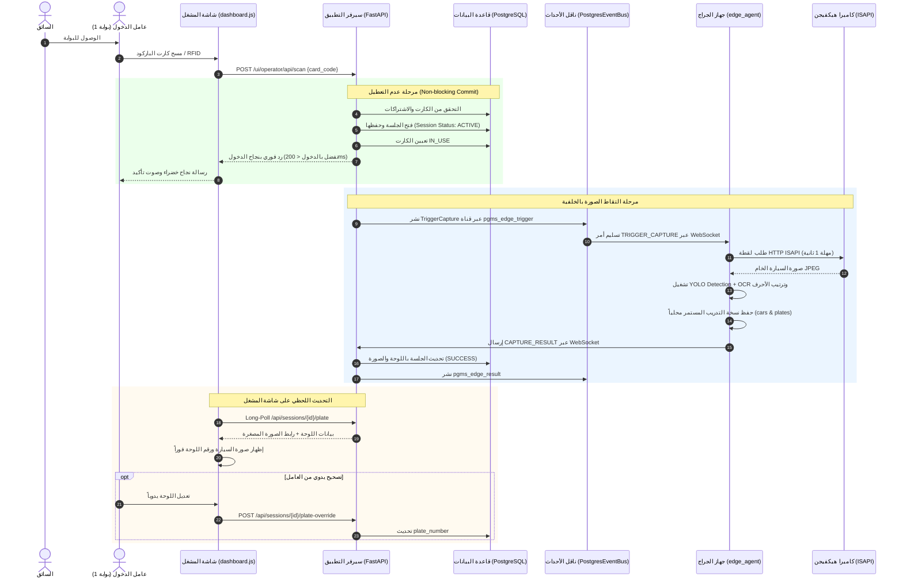
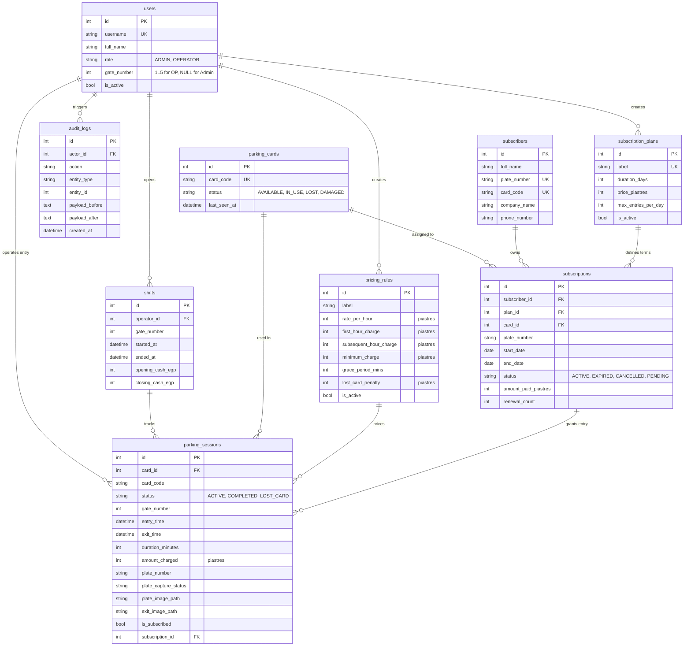

# الخطة المعمارية والتنفيذية الشاملة لنظام إدارة جراج باب اللوق (PGMS — Garage4U)

> **الحالة:** الوثيقة المعمارية والتنفيذية الرسمية الحاكمة للمشروع.  
> **المصدر:** مستخرجة ومحققة بالكامل بنسبة 100% من الكود المصدري الفعلي (`models/`، `services/`، `routes/`، `config.py`، `edge_agent/`).  
> **ملاحظة:** تُلغي هذه الوثيقة وتستبدل أي خطط نظرية أو مسودات قديمة (مثل خطط Sunmi POS التي لم تُنفذ).

---

## 1. نظرة عامة ومعمارية النظام الشاملة (System Architecture)

نظام **Garage4U (PGMS — Parking Garage Management System)** في جراج باب اللوق هو حل برمجي غير متزامن فائق السرعة، مصمم لإدارة حركة المركبات، تسجيل الدخول والخروج، احتساب الرسوم بدقة متناهية، إدارة الاشتراكات، وتشغيل كاميرات المراقبة والتعرف الآلي على لوحات السيارات (ANPR) في بيئة إنتاجية حقيقية.

### المخطط المعماري العام للربط الميداني

```text
┌────────────────────────────────────────────────────────────────────────────────────────┐
│                               GARAGE PHYSICAL WORKSTATIONS                             │
│                                                                                        │
│  ┌───────────────────────────────┐                  ┌───────────────────────────────┐  │
│  │   GATE 1: ENTRY WORKSTATION   │                  │    GATE 2: EXIT WORKSTATION   │  │
│  │   (Desktop PC / Browser)      │                  │    (Desktop PC / Browser)     │  │
│  │   - USB Barcode/RFID Reader   │                  │    - USB Barcode/RFID Reader  │  │
│  │   - Fast POS UI (ES5 / IE11)  │                  │    - 1-Step Exit Checkout     │  │
│  │   - Sound Feedback (WebAudio) │                  │    - ESC/POS Thermal 80/58mm  │  │
│  └───────────────┬───────────────┘                  └───────────────┬───────────────┘  │
└──────────────────┼──────────────────────────────────────────────────┼──────────────────┘
                   │                      HTTP (LAN / WAN)            │
                   ▼                                                  ▼
┌────────────────────────────────────────────────────────────────────────────────────────┐
│                                 GARAGE4U BACKEND SERVER                                │
│                     (FastAPI + Uvicorn + Multi-Worker Gunicorn)                        │
│                                                                                        │
│  ┌──────────────────────────────────────────────────────────────────────────────────┐  │
│  │ Routes Layer (HTTP UI & REST API)                                                │  │
│  │ - /ui/operator/* (Dashboard, Shift, Scan, Exit, Receipts)                        │  │
│  │ - /ui/admin/* (Live Dashboard, Sessions, Shifts, Rates, Reports, Cards)          │  │
│  │ - /ui/subscriptions/* (Subscribers, Plans, Excel/CSV Bulk Import)                │  │
│  │ - /api/v1/* (REST API JSON Envelopes for Automation & Integrations)              │  │
│  │ - /ws/edge (Secured WebSocket Broker for Garage Edge PC)                         │  │
│  └────────────────────────────────────────┬─────────────────────────────────────────┘  │
│                                           │                                            │
│  ┌────────────────────────────────────────▼─────────────────────────────────────────┐  │
│  │ Core Services Layer (Business Logic & Lifespan Tasks)                            │  │
│  │ - SessionService (Open, Close, Lost Card, Admin Override Close)                  │  │
│  │ - PricingService (Tiered Hourly Calculations, Grace Periods, Piastres Math)      │  │
│  │ - CardService (Barcode/RFID Normalization, Availability & Lifecycle)             │  │
│  │ - ShiftService (Opening Drawer Cash, Cash Reconciliation, Force Close)           │  │
│  │ - SubscriptionService (Plans, Active/Expired Lifecycle, Daily Entry Limits)      │  │
│  │ - ExcelImportService (Smart Column Matching, Import Preview & Validation)        │  │
│  │ - ReportService (Live Stats KPIs, Gate Panel, Revenue Analysis, CSV Export)      │  │
│  │ - PlateCaptureService & PlateService (Egyptian Format Normalization & Validation)│  │
│  │ - AuditService (Immutable Security Audit Trail)                                  │  │
│  └────────────────────────────────────────┬─────────────────────────────────────────┘  │
│                                           │                                            │
│  ┌────────────────────────────────────────▼─────────────────────────────────────────┐  │
│  │ Cross-Worker Event Bus & Edge Hub                                                │  │
│  │ - EdgeHub (Connection Tracking, Gate Presence, Heartbeats)                       │  │
│  │ - PostgresEventBus (LISTEN/NOTIFY across Gunicorn Workers: Trigger, Result)      │  │
│  └────────────────────────────────────────┬─────────────────────────────────────────┘  │
└───────────────────────────────────────────┼────────────────────────────────────────────┘
                                            │
                 ┌──────────────────────────┴──────────────────────────┐
                 │                                                     │
                 ▼                                                     ▼
┌──────────────────────────────────┐         ┌───────────────────────────────────────────┐
│     PERSISTENCE DATA LAYER       │         │       GARAGE LOCAL AI EDGE NETWORK        │
│                                  │         │                                           │
│ - PostgreSQL (Production asyncpg)│         │ ┌───────────────────────────────────────┐ │
│ - SQLite (Dev/Test aiosqlite)    │         │ │ Garage Edge PC (NVIDIA CUDA / PyTorch)│ │
│ - Database Migrations (Alembic)  │         │ │ - Outbound WebSocket to /ws/edge      │ │
│ - Stored Plate Images (media/)   │         │ │ - YOLOv8 Plate Detection (best.pt)    │ │
└──────────────────────────────────┘         │ │ - YOLOv8 Egyptian Character OCR       │ │
                                             │ │ - Continuous Training Dataset Logger  │ │
                                             │ └───────────────────▲───────────────────┘ │
                                             │                     │ HTTP ISAPI (LAN)    │
                                             │ ┌───────────────────┴───────────────────┐ │
                                             │ │ Hikvision IP Surveillance Cameras     │ │
                                             │ │ - Gate 1 Entry (Channel 201 ISAPI)    │ │
                                             │ │ - Gate 2 Exit  (Channel 101 ISAPI)    │ │
                                             │ └───────────────────────────────────────┘ │
                                             └───────────────────────────────────────────┘
```

### القرارات المعمارية الحاكمة للمشروع

1. **الواجهات من جانب السيرفر (Server-Side Rendering — SSR):**
   - استخدام قوالب Jinja2 في توليد شاشات المشغل والإدارة بدلاً من أطر عمل SPA الثقيلة.
   - توفير استجابة فائقة السرعة على الحواسب المكتبية الاقتصادية في البوابات، وضمان توافق كامل مع متصفحات قديمة (بما فيها IE11 بفضل Polyfills مخصصة في `static/js/dashboard.js`).
2. **المصادقة الهجينة (Dual Authentication):**
   - كوكيز مشفرة ومؤمنة `HttpOnly` باسم `pgms_token` لصفحات الويب لمنع سرقتها عبر سكريبتات XSS.
   - ترويسة `Authorization: Bearer <token>` للواجهات البرمجية REST APIs واتصالات الـ WebSockets.
3. **الحسابات المالية بالقروش كأعداد صحيحة حصراً (Integer Piastres Math):**
   - كافة القيم المالية في قاعدة البيانات تُخزن كأعداد صحيحة (`Integer`) تمثل القروش (1 جنيه = 100 قرش).
   - منع الأرقام العشرية (`Float`) نهائياً لمنع أخطاء التقريب والكسور المئوية.
4. **التوقيت الزمني المصري (Cairo Timezone & DST):**
   - توثيق التواريخ في قاعدة البيانات بصيغة UTC محايدة (`naive UTC`).
   - تحويل وحساب الورديات وبدايات الأيام والتقارير بتوقيت القاهرة المحلي `Africa/Cairo` مع مراعاة التوقيت الصيفي المصري تلقائياً.

---

## 2. معمارية نظام الكاميرا والـ Edge Agent (`edge_agent/`)

يتولى مجلد `edge_agent/` معالجة الرؤية الحاسوبية والذكاء الاصطناعي على حاسوب محلي داخل الجراج مرتبط بالكاميرات.

```text
[Hikvision Camera] 
       │ (1) HTTP ISAPI GET (Digest Auth)
       ▼
[camera.py: SnapshotCamera]
       │ (2) Raw JPEG Frame
       ▼
[recognizer.py: EgyptianPlateRecognizer]
       │ (3) YOLO Detection -> Crop Plate Bounding Box
       │ (4) YOLO OCR -> Egyptian Characters/Digits -> Arabic RTL Sorting
       │ (5) Encode WebP / JPEG
       ▼
[agent.py: EdgeAgent]
       │ (6) Send CAPTURE_RESULT JSON Frame
       ▼
[WebSocket: /ws/edge] ---> [VPS: routes/edge_ws.py]
```

### أ. مكونات وكيل الجراج (`edge_agent/`)

| المكون / الملف | الوظيفة البرمجية المنفذة في الكود |
|---|---|
| `agent.py` | العميل الرئيسي (Client): يفتح اتصال WebSocket خارجي صادر مع السيرفر، يعالج أحداث `TRIGGER_CAPTURE`، يدير الأقفال المتزامنة لكل بوابة (`_gate_locks`)، ويعيد إرسال النتائج المخزنة مؤقتاً في طابور `_outbox` عند انقطاع الشبكة. |
| `camera.py` | عميل `SnapshotCamera`: يستعلم لقطات الكاميرات عبر الشبكة المحلية باستخدام `httpx.AsyncClient` مع الحفاظ على الاتصال مفتوحاً (HTTP Keep-Alive) ومصادقة Digest Auth لتفادي تكرار مصافحة 401 في كل لقطة. |
| `recognizer.py` | محرك الذكاء الاصطناعي `EgyptianPlateRecognizer`: يشغل موديل كشف مكان اللوحة وموديل القراءة الضوئية للأحرف، ويرتب الحروف من اليمين لليسار وفق النمط المصري. |
| `settings.py` | فئة الإعدادات `EdgeSettings` المستندة إلى Pydantic لقراءة المتغيرات من `.env` وضبط عناوين الكاميرات والأوزان ونسب الثقة. |

### ب. بروتوكول كاميرات هيكفيجن (Hikvision ISAPI)
- تسحب الصور عبر منفذ HTTP ISAPI:
  - كاميرا بوابة الدخول 1: `http://192.168.1.100/ISAPI/Streaming/channels/201/picture`
  - كاميرا بوابة الخروج 2: `http://192.168.1.100/ISAPI/Streaming/channels/101/picture`
- المصادقة: مصادقة هضمية **Digest Authentication** لضمان أعلى مستوى أمان على الشبكة المحلية.

### ج. خط أنابيب الذكاء الاصطناعي (YOLOv8 Pipeline)
1. **كشف اللوحة (Plate Localization):**
   - استخدام الموديل المدرب `plate_detection/best.pt` على جهاز الـ GPU عبر PyTorch (`device="cuda"`).
   - استخراج أعلى مربع إحاطة موثوق به (`bbox`) وقص صورة اللوحة (`best_plate_crop`).
2. **قراءة الرموز ضوئياً (Character OCR):**
   - تمرير قصاصة اللوحة لموديل `plate_recognition/best.pt`.
   - استخراج معرّفات الأحرف والأرقام ونسب ثقتها.
   - **الترتيب الذكي من اليمين إلى اليسار (Arabic RTL):** ترتيب الرموز تنازلياً وفق الإحداثي السيني الأفقي `X` لضمان قراءة الحروف العربية أولاً ثم الأرقام.
3. **التجميع وحساب الثقة المركبة:**
   - احتساب متوسط ثقة التعرف الضوئي مضروباً في ثقة الكشف للخروج بنسبة دقة نهائية (`composite_conf`).
4. **حفظ بيانات التدريب المستمر (Dataset Preservation):**
   - يتم تفعيل ميزة `SAVE_LOCAL_DATASET: True` تلقائياً.
   - حفظ صورة السيارة الكاملة في المجلد `DATASET_DIR/gate_{id}/cars/`.
   - حفظ صورة قصاصة اللوحة في المجلد `DATASET_DIR/gate_{id}/plates/`.
   - تسجيل بيانات السجل (الوقت، رقم الجلسة، البوابة، النص، نسبة الثقة، المسارات) في ملف `dataset_index.csv`.

---

## 3. تدفق التعرف على اللوحات خطوة بخطوة (ANPR Pipeline Flow)

### أ. تدفق بوابة الدخول (Gate 1 Entry Flow)



### ب. جدول المهل الزمنية وضمان تدفق الحركة (Timeouts & Non-Blocking Design)

| المرحلة | المهلة القصوى | السلوك عند انتهاء المهلة أو الفشل |
|---|---|---|
| **اعتماد دخول السيارة** | فوري (< 200ms) | الجلسة تُحفظ في الداتابيز والبوابة تُفتح فوراً؛ لا تنتظر الكاميرا إطلاقاً. |
| **لقطة الكاميرا ISAPI** | 1.0 ثانية | إذا تأخرت الكاميرا يُلغى الطلب وتُسجل حالة `CameraError`. |
| **معالجة الذكاء الاصطناعي بالجراج** | 3.5 ثانية | محسوبة كفارق شبكة 500ms قبل مهلة السيرفر الإجمالية. |
| **مهلة السيرفر الإجمالية** | 4.0 ثوانٍ (`PLATE_CAPTURE_TIMEOUT_S`) | تتحول حالة التقاط اللوحة إلى `TIMEOUT`، وتستمر الجلسة بشكل طبيعي. |
| **في حال انقطاع الـ Edge PC** | فوري (0 ثانية) | إذا كان الجهاز غير متصل، تُسجل الحالة فوراً كـ `OFFLINE` دون أي تأخير. |
| **النتائج المتأخرة (Late Results)** | حتى 120 ثانية | لو وصلت نتيجة متأخرة بسبب بطء اتصال الـ 4G، تُخزن في الجلسة كمرجع تاريخي. |

### ج. تدفق بوابة الخروج والحساب الفوري (Gate 2 Exit Flow)
1. مسح الكارت في شاشة الخروج.
2. النظام يستدعي `session_service.close_session`:
   - حساب مدة الوقوف الدقيقة بالساعات والدقائق.
   - خصم فترة السماح (`grace_period_mins`).
   - احتساب تكلفة الساعة الأولى والساعات التالية أو السعر الثابت.
   - للمشترك النشط: الرسوم = 0 ج.م، ويبقى الكارت مرتبطاً به.
3. إنهاء الجلسة `SessionStatus.COMPLETED` وتحرير الكارت العادي ليكون متاحاً `AVAILABLE`.
4. **لقطة الخروج التأكيدية:** استدعاء `start_exit_capture` بنوع `capture_type: "exit"` و `skip_ocr: True`.
   - تلتقط الكاميرا لقطة السيارة وتُخزن في مسار `exit_image_path` لتوثيق هيئة السيارة عند المغادرة لأغراض الرقابة الإدارية.
5. استدعاء الطباعة الحرارية التلقائية للإيصال (`/ui/operator/receipt/{id}`).

---

## 4. هيكلة وتدفق أحداث الـ WebSocket وربطها بـ PostgresEventBus

### أ. تحدي تعدد العمليات في بيئة الإنتاج (Multi-Worker Challenge)
في بيئة الإنتاج، يعمل الخادم عبر **Gunicorn بـ 3 عمال (Workers)**:
- اتصال الـ WebSocket القادم من حاسوب الجراج يستقر في **Worker واحد فقط**.
- طلب مسح الكارت من المشغل أو استطلاع النتيجة (Long-polling) قد يصل إلى **أي Worker آخر**.
- لضمان وصول أوامر التصوير من أي Worker إلى جهاز الجراج، ووصول نتيجة القراءة إلى Worker المشغل، تم تنفيذ **PostgresEventBus** كحل معماري عبقري يعتمد على قدرات PostgreSQL الأصيلة (`LISTEN / NOTIFY`).

```text
[Operator Browser] ─────────> [Gunicorn Worker A]
                                     │
                             (SQL pg_notify)
                                     ▼
                            ┌──────────────────┐
                            │    PostgreSQL    │
                            │  LISTEN/NOTIFY   │
                            └────────┬─────────┘
                                     │
                             (asyncpg listener)
                                     ▼
                              [Gunicorn Worker B]
                                     │
                             (Starlette WebSocket)
                                     ▼
                              [Garage Edge PC]
```

### ب. هيكل قنوات الـ EventBus

| اسم القناة في الداتابيز | اتجاه البيانات | الغرض والبيانات المنقولة |
|---|---|---|
| `pgms_edge_trigger` | من أي Worker إلى Worker الـ WebSocket | إرسال أمر التصوير `TriggerCapture` المحتوي على `session_id`, `card_uid`, `gate_id`, `timeout_ms`. |
| `pgms_edge_result` | من Worker الـ WebSocket إلى باقي الـ Workers | إشعار كافة المعالجات بانتهاء قراءة اللوحة للجلسة `{"session_id": 123}` لإيقاظ طلبات الانتظار. |
| `pgms_edge_presence` | بين كافة الـ Workers | بث نبضات اتصال أجهزة الجراج وتحديث جدول الوجود اللحظي (`conn_id`, `gates`, `online`). |

### ج. هياكل حزم البيانات (WebSocket JSON Frame Schemas)

#### 1. مصافحة بدء الاتصال (Handshake)
- **طلب العميل (Client -> Server):**
  ```json
  {
    "event": "HELLO",
    "node_id": "garage-edge-1",
    "gates": [1, 2],
    "version": "1.0.0"
  }
  ```
- **رد السيرفر (Server -> Client):**
  ```json
  {
    "event": "HELLO_ACK",
    "conn_id": "a1b2c3d4e5f6..."
  }
  ```

#### 2. أمر طلب الالتقاط (Capture Trigger)
- **من السيرفر إلى العميل (Server -> Edge):**
  ```json
  {
    "event": "TRIGGER_CAPTURE",
    "session_id": 4501,
    "card_uid": "CARD-0082",
    "gate_id": 1,
    "timeout_ms": 3000,
    "capture_type": "entry",
    "skip_ocr": false
  }
  ```

#### 3. إرسال نتيجة المعالجة (Capture Result)
- **من العميل إلى السيرفر (Edge -> Server):**
  ```json
  {
    "event": "CAPTURE_RESULT",
    "session_id": 4501,
    "gate_id": 1,
    "capture_type": "entry",
    "status": "SUCCESS",
    "plate_number": "ق ط ر 9 2 5",
    "confidence": 0.892,
    "image_webp_b64": "UklGRuAAAABXRUJQVlA4...",
    "timings_ms": {
      "snapshot": 310.2,
      "analyse": 480.5,
      "total": 820.1
    }
  }
  ```

#### 4. إقرار استلام السيرفر (Result Acknowledgment)
- **من السيرفر إلى العميل (Server -> Edge):**
  ```json
  {
    "event": "RESULT_ACK",
    "session_id": 4501,
    "accepted": true,
    "reason": null
  }
  ```

---

## 5. قاعدة البيانات والكيانات الفعلية (Implemented Database Schema)

### المخطط العلائقي الكامل (Entity Relationship Diagram)



---

## 6. خارطة المراحل المنفذة فعلياً في الكود (Actual Implemented Phases)

توضح هذه الخارطة ما تم بناؤه واختباره واعتماده فعلياً في المستودع بنسبة 100%:

### المرحلة 1: النواة المعمارية والمصادقة المزدوجة (Phase 1 — Core & Auth) — [مكتملة 100%]
- [x] إعداد هيكل المشروع النظيف (Clean Architecture) وفصل الطبقات (`models/`, `repositories/`, `services/`, `routes/`, `schemas/`).
- [x] محرك قواعد البيانات غير المتزامن المزدوج (`PostgreSQL` للإنتاج و `SQLite` للتطوير/الاختبارات).
- [x] إدارة التهجيرات الكاملة عبر `Alembic`.
- [x] دورة حياة التطبيق `FastAPI Lifespan` مع فحص صحة الاتصال بالداتابيز.
- [x] نموذج المستخدمين `User` وتطبيق قيد التحقق الصارم بين الدور ورقم البوابة (`ck_users_role_gate_consistency`).
- [x] خدمة المصادقة `AuthService` بتشفير `bcrypt` وإصدار رموز JWT.
- [x] حماية أمنية مزدوجة: كوكيز `pgms_token` المشفرة للواجهات + `Bearer Token` للواجهات البرمجية.
- [x] سكريبت البذر المبدئي `seed.py` لتوليد حسابات المشغلين والمديرين ولائحة الأسعار الافتراضية.

### المرحلة 2: تشغيل الجراج وإدارة الكروت والتسعير (Phase 2 — Parking Operations & Pricing) — [مكتملة 100%]
- [x] نظام مخزون الكروت `ParkingCard` مع التوليد الفردي والمدى وتوليد الدفعات (`/bulk`, `/range`).
- [x] خدمة الكروت `CardService` والتحقق من صيغة الباركود وتوحيده بالأحرف الكبيرة.
- [x] دورة حياة جلسات الانتظار `ParkingSession` مع منع التكرار بفهرس جزئي فريد (`idx_active_card_id`).
- [x] محرك احتساب الأسعار المتقدم `PricingService`:
  - دعم التسعير الشرائحي: سعر الساعة الأولى (`first_hour_charge`) والساعات اللاحقة (`subsequent_hour_charge`).
  - دعم التسعير الثابت بالساعة (`rate_per_hour`).
  - خصم فترة السماح (`grace_period_mins`) واحتساب الحد الأدنى (`minimum_charge`).
- [x] مسار الكروت المفقودة المخصص واحتساب غرامة فقد الكارت (`lost_card_penalty`).
- [x] خدمة الورديات `ShiftService` والمطابقة النقدية الدقيقة وحساب الفوارق والعجز.
- [x] واجهة المشغل فائقة السرعة POS في `templates/operator/dashboard.html` و `static/js/dashboard.js` الداعمة للماسح بنمط Wedge ونغمات الصوت عبر Web Audio API.
- [x] قوالب طباعة الإيصالات الحرارية القياسية (80mm / 58mm).

### المرحلة 3: لوحة الإدارة والتحليلات الحية والتقارير (Phase 3 — Admin & Analytics) — [مكتملة 100%]
- [x] لوحة الإحصائيات اللحظية (Live Stats): نسبة الإشغال، عدد السيارات النشطة، إيراد اليوم، والسيارات المقيمة لأكثر من 24 ساعة.
- [x] لوحة مراقبة البوابات المباشرة (Gate Panel 1–5): متابعة المشغلين النشطين والورديات لحظياً.
- [x] مستكشف الجلسات الشامل مع فلاتر التاريخ، البوابة، المشغل، الحالة، اللوحة، والكارت.
- [x] آلية التسوية والإغلاق الإداري للجلسات العالقة (`admin_override_close_session`) مع تدوين الملاحظات الإدارية الإجبارية.
- [x] تقارير الإيرادات الموزعة: حسب البوابة، نوع الخدمة، المشغل، والمنحنى اليومي.
- [x] تصدير كامل إلى ملفات CSV للجلسات والورديات والتقارير المالية.
- [x] قوالب طباعة تقارير الحسابات الرسمية (`templates/admin/reports/print.html`).

### المرحلة 4: نظام المشتركين وإدارة الأساطيل والاستيراد (Phase 4 — Subscriptions & Fleet) — [مكتملة 100%]
- [x] نماذج بيانات `Subscriber`, `SubscriptionPlan`, و `Subscription`.
- [x] دعم الخطط المخصصة بالأسعار الحرة والمدد المتغيرة إلى جانب الخطط الثابتة.
- [x] التحقق التلقائي عند دخول المشتركين ومنح الدخول المجاني الفوري.
- [x] تنبيه المشغل عند محاولة دخول كارت اشتراك منتهي الصلاحية مع خيار المتابعة كتذكرة عادية.
- [x] فحص وتطبيق الحد الأقصى للدخول اليومي للمركبة (`max_entries_per_day`).
- [x] المزامنة التلقائية عند إقلاع السيرفر: إنهاء الاشتراكات المنتهية وتفعيل المؤجلة وتسجيلها في سجل التدقيق.
- [x] محرك الاستيراد الجماعي الذكي من إكسيل و CSV (`ExcelImportService`):
  - التعرّف التلقائي على الأعمدة العربية والإنجليزية لكود الكارت، اسم الموظف، اللوحة، الشركة، والهاتف.
  - المعاينة المطابقة والفحص الدقيق للأخطاء قبل الحفظ الفعلي.
  - إتاحة تحميل قالب إكسيل جاهز للمشتركين.

### المرحلة 5: الذكاء الاصطناعي والكاميرات الموزعة (Phase 5 — Edge AI & ANPR) — [مكتملة 100%]
- [x] تطوير وكيل الجراج المستقل `edge_agent/` المتصل ببطاقة الرسوميات NVIDIA CUDA.
- [x] ربط كاميرات Hikvision عبر بروتوكول HTTP ISAPI ومصادقة Digest Auth.
- [x] تشغيل موديلات YOLOv8 لكشف اللوحات وOCR الحروف والأرقام المصرية مع الترتيب من اليمين لليسار.
- [x] بناء اتصال WebSocket مشفر وعكسي (`/ws/edge`) لتجاوز مشاكل الشبكة المحلية والـ NAT بالجراج.
- [x] تنفيذ ناقل الأحداث الموزع بين العمليات `PostgresEventBus` عبر `LISTEN/NOTIFY`.
- [x] تدفق الدخول فائق السرعة غير المعطل لحركة المرور (Non-blocking Entry).
- [x] التقاط لقطات الخروج التأكيدية التلقائية بدون تشغيل الـ OCR لتوفير الموارد وسرعة الخدمة.
- [x] التعديل اليدوي السريع للوحة من شاشة المشغل وحفظه فوراً في قاعدة البيانات.
- [x] الأرشفة التلقائية المستمرة للصور واللوحات على جهاز الجراج لتغذية تدريب الموديلات دورياً.

---

## 7. القواعد الإلزامية ودليل الصيانة والتشغيل (Operational Rules)

1. **التعامل مع المبالغ المالية:**
   - الحسابات في الداتابيز: **قروش صحيحة حصراً** (`int`).
   - لا تستخدم `float` نهائياً. يتم التحويل من وإلى الجنيه في واجهات العرض ومخططات Pydantic فقط (`amount_piastres / 100`).
2. **سجل التدقيق الإجباري (Audit Trail):**
   - أي عملية تعديل أو تسوية أو دخول أو خروج يجب أن تمر عبر `audit_service.log`.
   - يتم تجريد كلمات المرور تلقائياً من أي حمولة بيانات قبل تخزينها في جدول `audit_logs`.
3. **أمان وحصانة البوابات:**
   - فشل أي كاميرا أو بطء شبكة أو انقطاع جهاز الذكاء الاصطناعي لا يجوز أن يوقف دخول أو خروج السيارات.
   - حركة المرور الفيزيائية هي الأولوية الأولى، والكاميرات والـ OCR هي ميزات تعزيز رقابي وتوثيق غير متزامن.
4. **صيانة وتدوير مساحة تخزين الصور (Storage Housekeeping):**
   - تتراكم صور السيارات المقروءة بصيغة WebP في مسار `media/plates/` بالسيرفر (حوالي 3 جيجابايت شهرياً لمعدل 1000 سيارة يومياً).
   - يُنصح بتشغيل أمر صيانة دوري (Cron Job) لحذف الصور التي تجاوزت 90 يوماً:
     ```bash
     find /srv/pgms-babelooq/app/media/plates -type f -name '*.webp' -mtime +90 -delete
     ```