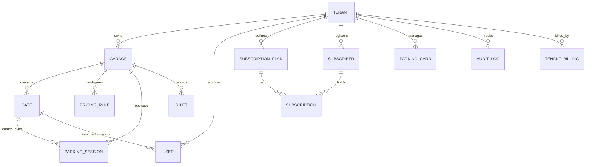

# Phase 5 Specification — Multi-Tenant SaaS Transformation (Garage4U SaaS)

> **Version:** 1.0  
> **Status:** Approved Architecture Specification  
> **Target System:** Garage4U (PGMS — Parking Garage Management System)  
> **Prerequisite Reading:** `docs/constitution.md`, `docs/master-plan.md`, `docs/specs/phase-1-core/spec.md`, `docs/specs/phase-2-operator/spec.md`, `docs/specs/phase-3-admin/spec.md`, `docs/specs/phase-4-subscriptions/spec.md`  
> **Primary Goal:** Transform the single-garage Babelooq system into an enterprise-grade, multi-tenant SaaS platform capable of managing hundreds of commercial parking operators, shopping malls, airports, and private garage chains across multiple branches and gates with zero cross-tenant data leakage, sub-second POS transactions, and multi-tenant AI Edge Camera integration.

---

## 1. Executive Summary & Architectural Vision

### 1.1 The Business Need
The Babelooq implementation proved that Garage4U delivers industry-leading reliability, sub-second POS ticket issuance, resilient offline edge camera ANPR, and zero-float financial accounting. However, scaling to commercial operators managing multiple facilities (e.g., mall operators, parking management companies, municipal authorities) requires converting the architecture from a single-installation model into a **Centralized Multi-Tenant Software-as-a-Service (SaaS)** platform.

### 1.2 Core Architectural Principles
1. **Shared Database with Discriminator (`tenant_id`) & Row-Level Security (RLS):**
   - Single database deployment for optimal resource efficiency and unified migrations.
   - Every tenant-scoped entity contains an indexed, non-nullable foreign key `tenant_id`.
   - Architectural defense-in-depth: Python `contextvars`-based `TenantContext` in SQLAlchemy queries paired with PostgreSQL Row-Level Security (`SET LOCAL app.current_tenant_id`) prevents any cross-tenant data leaks.
2. **Hierarchical Multi-Branch Domain Model:**
   - **Tenant (المستأجر / الشركة):** The commercial enterprise account (e.g., "Capital Parking Group").
   - **Garage / Branch (الفرع / الجراج):** A physical parking location operated by the tenant (e.g., "Babelooq Garage", "Opera Garage").
   - **Gate (البوابة):** Physical entry/exit lane within a garage with hardware peripherals (e.g., "Gate 1 Entry", "Gate 2 Exit").
   - **Edge Agent (وكيل الذكاء الاصطناعي):** Scoped to specific gates within a garage under the tenant.
3. **Preservation of Core Guarantees:**
   - **Zero Float Math:** All monetary figures remain integer piastres (`price_piastres`, `amount_piastres`).
   - **Ultra-Fast POS:** Gate workstations continue executing 1-step scans without latency penalty from multi-tenancy.
   - **Local Workstation Compatibility:** Barcode scanners, thermal receipt printers (80mm/58mm), and legacy browser polyfills (IE11/ES5) function identically.
   - **Zero-Downtime Babelooq Migration:** Existing Babelooq data is mapped seamlessly to Tenant #1 (`slug="babelooq"`, `garage_id=1`) with full backward compatibility.

---

## 2. System Architecture & Component Diagram

```text
┌────────────────────────────────────────────────────────────────────────────────────────┐
│                              CLIENT TRAFFIC ENTRYPOINTS                                │
│                                                                                        │
│  ┌─────────────────────────┐  ┌─────────────────────────┐  ┌─────────────────────────┐ │
│  │   Tenant A Subdomain    │  │   Tenant B Subdomain    │  │   Platform SuperAdmin   │ │
│  │  babelooq.garage4u.io   │  │    capital.garage4u.io  │  │    admin.garage4u.io    │ │
│  └────────────┬────────────┘  └────────────┬────────────┘  └────────────┬────────────┘ │
└───────────────┼────────────────────────────┼────────────────────────────┼──────────────┘
                │                            │                            │
                ▼                            ▼                            ▼
┌────────────────────────────────────────────────────────────────────────────────────────┐
│                           FASTAPI REVERSE PROXY & GATEWAY                              │
│                                                                                        │
│  ┌──────────────────────────────────────────────────────────────────────────────────┐  │
│  │ TenantResolverMiddleware                                                         │  │
│  │ - Resolves Tenant by: Subdomain -> Custom Domain -> X-Tenant-ID -> JWT Claim     │  │
│  │ - Injects TenantContext into contextvars and Request.state.tenant                │  │
│  │ - Validates Tenant status (ACTIVE, SUSPENDED, TRIAL)                             │  │
│  └────────────────────────────────────────┬─────────────────────────────────────────┘  │
│                                           │                                            │
│  ┌────────────────────────────────────────▼─────────────────────────────────────────┐  │
│  │ Application Routers Layer                                                        │  │
│  │ - /superadmin/*       (Platform metrics, tenant lifecycle, billing plans)        │  │
│  │ - /ui/admin/*         (Tenant-scoped dashboard, branches, rates, subscriptions)  │  │
│  │ - /ui/operator/*      (Garage & gate-scoped POS scanning and shifts)             │  │
│  │ - /api/v1/*           (Tenant-scoped REST APIs for mobile & integrations)        │  │
│  │ - /ws/edge            (Tenant-authenticated WebSocket broker for Edge Agents)     │  │
│  └────────────────────────────────────────┬─────────────────────────────────────────┘  │
│                                           │                                            │
│  ┌────────────────────────────────────────▼─────────────────────────────────────────┐  │
│  │ Tenant-Scoped Services Layer                                                      │  │
│  │ - SessionService (tenant_id, garage_id, gate_id)                                 │  │
│  │ - PricingService (tenant_id, garage_id)                                          │  │
│  │ - ShiftService & CardService (tenant_id, garage_id)                              │  │
│  │ - SubscriptionService (tenant_id)                                                │  │
│  │ - MultiTenantEdgeHub & Namespaced PostgresEventBus                               │  │
│  └────────────────────────────────────────┬─────────────────────────────────────────┘  │
└───────────────────────────────────────────┼────────────────────────────────────────────┘
                                            │
               ┌────────────────────────────┴────────────────────────────┐
               ▼                                                         ▼
┌──────────────────────────────────────────────┐        ┌────────────────────────────────┐
│         POSTGRESQL MULTI-TENANT DB           │        │   MULTI-GARAGE EDGE NETWORK    │
│                                              │        │                                │
│ - Shared schema with tenant_id foreign keys  │        │ [Babelooq Edge PC]             │
│ - Row Level Security (RLS) enforcement       │        │   └── wss://... (Tenant 1)     │
│ - Scoped indexes: (tenant_id, created_at)    │        │ [Capital Mall Edge PC]         │
│ - Media paths: media/tenants/{tenant_id}/... │        │   └── wss://... (Tenant 2)     │
└──────────────────────────────────────────────┘        └────────────────────────────────┘
```

---

## 3. Domain Model & Hierarchy

### 3.1 Entity Relationship Hierarchy


### 3.2 Tenant Isolation Matrix

| Model | Multi-Tenancy Scope | Isolation Column | Description |
|---|---|---|---|
| `Tenant` | Platform Root | `id` | Root company / organization entity |
| `TenantBilling` | Platform Root | `tenant_id` | SaaS plan, billing cycles, quotas |
| `Garage` | Tenant-scoped | `tenant_id` | Physical parking branch |
| `Gate` | Garage-scoped | `tenant_id`, `garage_id` | Physical entry/exit lane |
| `User` | Tenant-scoped | `tenant_id`, `garage_id` (optional) | Staff members; SuperAdmin has `tenant_id = NULL` |
| `ParkingCard` | Tenant-scoped | `tenant_id` | Physical RFID/Barcode inventory |
| `PricingRule` | Garage-scoped | `tenant_id`, `garage_id` | Hourly/tiered parking tariffs per garage |
| `ParkingSession` | Gate-scoped | `tenant_id`, `garage_id`, `gate_id` | Vehicle entry/exit records |
| `Shift` | Gate-scoped | `tenant_id`, `garage_id`, `gate_id` | Cashier shifts and cash reconciliations |
| `Subscriber` | Tenant-scoped | `tenant_id` | Vehicle owners with subscriptions |
| `SubscriptionPlan` | Tenant-scoped | `tenant_id` | Plans available within the tenant organization |
| `Subscription` | Tenant-scoped | `tenant_id` | Active or expired subscription instances |
| `AuditLog` | Tenant-scoped | `tenant_id` | Immutable security trail (SuperAdmin logs have `tenant_id = NULL`) |

---

## 4. User Roles & Permission Matrix

Phase 5 extends the authentication and authorization model to support hierarchical SaaS operations:

| Role | Scope | Key Capabilities |
|---|---|---|
| `SUPER_ADMIN` | Global Platform | Full platform control, provisioning tenants, configuring SaaS billing, viewing global revenue, impersonating tenant admins for debugging. |
| `TENANT_ADMIN` | Single Tenant | Full control over tenant organization: creating garages, gates, managing tariffs, managing subscription plans, adding staff users, viewing cross-garage analytics. |
| `GARAGE_MANAGER` | Specific Garage | Manages day-to-day operations of an assigned garage: shifts, cashier assignments, lost card overrides, manual session adjustments, local rate scheduling. |
| `OPERATOR` | Specific Gate | Handles live POS check-in and check-out at their assigned gate, opens/closes cashier shifts, processes plate override corrections. |
| `AUDITOR` | Tenant or Garage | Read-only access to financial reports, session histories, shift reconciliation logs, and audit trails. |

---

## 5. Tenant Resolution & Request Pipeline

### 5.1 Resolution Strategy Order
When an incoming HTTP/WebSocket request arrives, `TenantResolverMiddleware` evaluates the tenant in the following strict precedence:

1. **Host Header / Subdomain:**
   - Request to `al-azhar.garage4u.io` resolves tenant by `slug = "al-azhar"`.
   - Request to custom domain `parking.cairofestivalcity.com` resolves tenant by `custom_domain`.
2. **Explicit HTTP Header:**
   - `X-Tenant-ID: <id>` or `X-Tenant-Slug: <slug>` (primarily for API clients, automated scripts, and test runners).
3. **Authenticated JWT Token Claim:**
   - If user is authenticated via cookie `pgms_token` or `Authorization: Bearer`, the token contains `tid: <tenant_id>`.
4. **URL Path Prefix Fallback:**
   - `/t/{tenant_slug}/*` routes for unified domain deployments.
5. **SuperAdmin Exemption:**
   - Requests to `admin.garage4u.io` or `/superadmin/*` bypass tenant resolution and require `role = SUPER_ADMIN`.

### 5.2 ContextVar Lifecycle (`TenantContext`)
```python
# Conceptual execution flow per request:
# 1. Middleware parses and validates tenant
tenant = await tenant_repo.get_by_slug(slug)
if not tenant or not tenant.is_active:
    raise TenantNotFoundError or TenantSuspendedError()

# 2. Token sets contextvar
token = tenant_context.set(tenant)
try:
    # 3. SQLAlchemy session sets PostgreSQL RLS local variable
    await db.execute(text("SET LOCAL app.current_tenant_id = :tid"), {"tid": tenant.id})
    # 4. Route handler executes normally
    return await call_next(request)
finally:
    tenant_context.reset(token)
```

---

## 6. Distributed Edge Hub & EventBus in Multi-Tenant Environments

In Phase 5, multiple garages connect their local Edge AI PCs simultaneously over WebSocket `/ws/edge`. Cross-tenant crosstalk must be mathematically impossible.

### 6.1 Tenant & Gate-Scoped Authentication
When an Edge Agent connects to `/ws/edge`:
1. It presents an `X-Edge-Token` (or HTTP query parameter `token`).
2. The server decodes and validates the token, extracting:
   - `tenant_id: int`
   - `garage_id: int`
   - `gate_id: int`
3. The WebSocket connection is registered in `MultiTenantEdgeHub` under a composite key:
   `(tenant_id, garage_id, gate_id)`.

### 6.2 PostgreSQL LISTEN/NOTIFY Namespacing
PostgreSQL `LISTEN/NOTIFY` channels are prefixed with the tenant and garage ID:
- **Trigger Channel:** `pgms_edge_trigger:{tenant_id}:{garage_id}`
- **Result Channel:** `pgms_edge_result:{tenant_id}:{garage_id}`
- **Presence Channel:** `pgms_edge_presence:{tenant_id}`

This ensures that camera triggers from Gate 1 in Babelooq Garage never reach Gate 1 in CityStars Garage, even when running across multiple Gunicorn workers.

---

## 7. User Stories & Acceptance Criteria

### 7.1 SuperAdmin — Platform Management & Provisioning

---

#### US-501 — Create New Tenant (Organization Provisioning)
> *As a SuperAdmin, I want to provision a new tenant account with its administrative credentials and quotas, so that a new parking operator can be onboarded to the SaaS platform.*

**Acceptance Criteria:**
- `GET /superadmin/tenants/new` renders the tenant provisioning form.
- Form fields:
  - `name`: Organization name (e.g., "Capital Parking Co", Arabic/English, required).
  - `slug`: URL identifier (lowercase alphanumeric + hyphens, unique, required, e.g., "capital-parking").
  - `plan_tier`: SaaS tier enum (`TRIAL`, `STARTER`, `GROWTH`, `ENTERPRISE`, required).
  - `max_garages`: Maximum allowed branches (integer, default 1).
  - `max_gates_per_garage`: Maximum allowed gates per branch (integer, default 2).
  - `admin_full_name`: Primary admin name (required).
  - `admin_username`: Primary admin username (unique, required).
  - `admin_password`: Initial secure password (minimum 8 characters, required).
  - `custom_domain`: Optional FQDN (e.g., "parking.capital.com").
- `POST /api/v1/superadmin/tenants` executes atomic transaction:
  1. Inserts record into `tenants`.
  2. Inserts record into `tenant_billings` with quotas and billing expiration date.
  3. Inserts initial `User` with role `TENANT_ADMIN` linked to the newly created `tenant_id`.
  4. Creates default `Garage` (Branch #1) and default `Gates` (Entry 1, Exit 2).
  5. Seeds baseline default pricing rule (1 hour grace, 10 EGP/hr) for the initial garage.
  6. Logs action `TENANT_PROVISIONED` in platform audit log.
- Duplicate slug returns `409 Conflict` with error code `TENANT_SLUG_ALREADY_EXISTS`.

---

#### US-502 — Suspend & Activate Tenant
> *As a SuperAdmin, I want to suspend a tenant for non-payment or policy violation, so that their staff and gates immediately lose system access while preserving all their data.*

**Acceptance Criteria:**
- `POST /api/v1/superadmin/tenants/{id}/suspend` updates `tenants.is_active = FALSE` and sets `status = "SUSPENDED"`.
- Reason for suspension is recorded in `tenants.suspension_reason` and logged to `audit_logs`.
- All active sessions for users under this tenant are invalidated immediately.
- Subsequent requests to `https://{tenant_slug}.garage4u.io/*` render a polite Arabic/English branded "Account Suspended / الحساب معلق" splash page with billing contact information.
- Active WebSockets from Edge Agents under this tenant are closed with WebSocket code `4003 (Tenant Suspended)`.
- `POST /api/v1/superadmin/tenants/{id}/activate` restores the tenant to `ACTIVE` status.

---

#### US-503 — Platform Dashboard & Aggregate Analytics
> *As a SuperAdmin, I want to see platform-wide KPIs (active tenants, total garages, active parking sessions, daily aggregate revenue, Edge AI health), so that I can monitor the overall SaaS platform health.*

**Acceptance Criteria:**
- `GET /superadmin/dashboard` renders global KPIs:
  - Total registered tenants, active tenants, suspended tenants.
  - Total active garages and connected edge camera agents.
  - Today's platform-wide vehicle movements (total entries, exits, active occupancy).
  - Today's aggregate transaction volume (in EGP) and platform MRR (Monthly Recurring Revenue).
- Filterable tenant list with status badges, garage count, active vehicle count, and quick impersonation login button.

---

### 7.2 Tenant Admin — Multi-Branch & Garage Management

---

#### US-504 — Multi-Garage (Branch) Management
> *As a Tenant Admin, I want to create and configure multiple parking garages within my organization, so that I can manage all my company's facilities from one central portal.*

**Acceptance Criteria:**
- `GET /ui/admin/garages` renders the list of branches owned by the tenant.
- Shows branch name, code, address, capacity (total spots), active occupancy, operational status, and assigned gates.
- `POST /api/v1/admin/garages` creates a new branch:
  - Fields: `name` (e.g., "فرع وسط البلد"), `code` (e.g., "WB-01"), `total_capacity` (integer), `address` (text), `timezone` (default "Africa/Cairo").
  - Validation: Tenant cannot exceed `max_garages` quota defined in their SaaS subscription tier. If exceeded, returns `403 Forbidden` with code `QUOTA_EXCEEDED_MAX_GARAGES`.
- Action logged in tenant audit log as `GARAGE_CREATED`.

---

#### US-505 — Gate & Hardware Configuration
> *As a Tenant Admin, I want to define gates for each garage and generate secure API credentials for Edge AI camera agents and cashier workstations.*

**Acceptance Criteria:**
- `GET /ui/admin/garages/{id}/gates` displays gate management view.
- Supports adding gates:
  - `gate_number`: 1 to 10 (unique within the garage).
  - `gate_name`: e.g., "بوابة الدخول الرئيسية (شارع شريف)".
  - `gate_type`: `ENTRY`, `EXIT`, or `BIDIRECTIONAL`.
  - `camera_ip_isapi`: Optional LAN URL for Hikvision camera.
- `POST /api/v1/admin/garages/{garage_id}/gates/{gate_id}/generate-edge-token` generates an encrypted Edge Agent secret token:
  - Token contains payload `{ "sub": "edge", "tid": tenant_id, "gid": garage_id, "gate_num": gate_number }`.
  - Token is displayed once to the admin with copy-to-clipboard functionality and an `.env` snippet ready for `edge_agent/settings.py`.

---

#### US-506 — Garage-Specific Pricing Rules (Tariffs)
> *As a Tenant Admin, I want to set different parking rates for each garage branch, so that prime downtown garages can charge differently than peripheral parking lots.*

**Acceptance Criteria:**
- `GET /ui/admin/rates?garage_id={id}` displays the tariff schedule for the selected branch.
- Each branch maintains an independent pricing model:
  - `first_hour_piastres`: e.g., 2000 (20 EGP).
  - `subsequent_hour_piastres`: e.g., 1000 (10 EGP).
  - `grace_period_minutes`: e.g., 15 minutes.
  - `lost_card_fee_piastres`: e.g., 10000 (100 EGP).
  - `max_daily_fee_piastres`: e.g., 15000 (150 EGP, nullable for uncapped).
- Changing rates in Garage A does not alter calculations in Garage B.
- All monetary inputs are converted to integer piastres before database commit.

---

### 7.3 Operator & Cashier — Branch-Aware POS Operations

---

#### US-507 — Branch & Gate Selection at Operator Login
> *As an Operator, when I log in, I want the system to bind my session to my designated garage and gate, so that my tickets, cash drawer, and shift belong to the correct facility.*

**Acceptance Criteria:**
- If an operator is assigned to a fixed garage and gate in `users.garage_id` and `users.gate_number`, the system automatically routes them to their POS dashboard.
- If an operator has floating permissions across branches, login displays a gate selection modal showing online gates for their active shift.
- The top navigation bar clearly displays: `[اسم المنشأة] - [اسم الفرع] - [بوابة X]`.
- All sessions opened by this operator automatically inherit `tenant_id`, `garage_id`, and `gate_id`.

---

#### US-508 — Cross-Branch Vehicle Roaming Validation
> *As an Operator, when a subscribed vehicle or ticket card arrives at my gate, the system must verify whether the card/subscription is valid for my specific garage or organization-wide.*

**Acceptance Criteria:**
- Subscription plans support `scope`: `ORGANIZATION_WIDE` (valid in all tenant garages) or `SINGLE_GARAGE` (valid only in the designated branch).
- If a subscriber with a `SINGLE_GARAGE` plan for Babelooq attempts to enter the Opera branch:
  - POS alert notifies operator: "الاشتراك غير مخصص لهذا الفرع — فرع الاشتراك: باب اللوق".
  - Prompt gives option to enter as a standard paid hourly ticket.
- Standard visitor parking cards (`parking_cards`) can be either organization-wide or pre-allocated per branch.

---

## 8. Database Schema Architecture

### 8.1 New Models

#### A. `tenants` Table
```sql
CREATE TABLE tenants (
    id SERIAL PRIMARY KEY,
    name VARCHAR(150) NOT NULL,
    slug VARCHAR(60) NOT NULL UNIQUE,
    custom_domain VARCHAR(255) UNIQUE,
    status VARCHAR(20) NOT NULL DEFAULT 'ACTIVE', -- ACTIVE, SUSPENDED, TRIAL, ARCHIVED
    logo_url VARCHAR(500),
    currency VARCHAR(10) NOT NULL DEFAULT 'EGP',
    timezone VARCHAR(50) NOT NULL DEFAULT 'Africa/Cairo',
    contact_email VARCHAR(120),
    contact_phone VARCHAR(30),
    notes TEXT,
    created_at TIMESTAMP WITH TIME ZONE NOT NULL DEFAULT NOW(),
    updated_at TIMESTAMP WITH TIME ZONE NOT NULL DEFAULT NOW()
);
CREATE INDEX ix_tenants_slug ON tenants(slug);
CREATE INDEX ix_tenants_custom_domain ON tenants(custom_domain);
CREATE INDEX ix_tenants_status ON tenants(status);
```

#### B. `tenant_billings` Table
```sql
CREATE TABLE tenant_billings (
    id SERIAL PRIMARY KEY,
    tenant_id INTEGER NOT NULL REFERENCES tenants(id) ON DELETE CASCADE,
    plan_tier VARCHAR(30) NOT NULL DEFAULT 'STARTER', -- TRIAL, STARTER, GROWTH, ENTERPRISE
    billing_cycle VARCHAR(20) NOT NULL DEFAULT 'MONTHLY', -- MONTHLY, ANNUAL
    price_piastres INTEGER NOT NULL DEFAULT 0,
    max_garages SMALLINT NOT NULL DEFAULT 1,
    max_gates_per_garage SMALLINT NOT NULL DEFAULT 2,
    max_subscribers INTEGER NOT NULL DEFAULT 100,
    enable_anpr BOOLEAN NOT NULL DEFAULT TRUE,
    expires_at TIMESTAMP WITH TIME ZONE,
    is_auto_renew BOOLEAN NOT NULL DEFAULT TRUE,
    created_at TIMESTAMP WITH TIME ZONE NOT NULL DEFAULT NOW(),
    updated_at TIMESTAMP WITH TIME ZONE NOT NULL DEFAULT NOW(),
    CONSTRAINT uq_tenant_billings_tenant UNIQUE(tenant_id)
);
```

#### C. `garages` Table
```sql
CREATE TABLE garages (
    id SERIAL PRIMARY KEY,
    tenant_id INTEGER NOT NULL REFERENCES tenants(id) ON DELETE CASCADE,
    name VARCHAR(150) NOT NULL,
    code VARCHAR(30) NOT NULL,
    address TEXT,
    city VARCHAR(60) NOT NULL DEFAULT 'القاهرة',
    total_capacity INTEGER NOT NULL DEFAULT 100,
    current_occupancy INTEGER NOT NULL DEFAULT 0,
    is_active BOOLEAN NOT NULL DEFAULT TRUE,
    settings JSONB NOT NULL DEFAULT '{}'::jsonb,
    created_at TIMESTAMP WITH TIME ZONE NOT NULL DEFAULT NOW(),
    updated_at TIMESTAMP WITH TIME ZONE NOT NULL DEFAULT NOW(),
    CONSTRAINT uq_garages_tenant_code UNIQUE(tenant_id, code)
);
CREATE INDEX ix_garages_tenant_id ON garages(tenant_id);
```

#### D. `gates` Table
```sql
CREATE TABLE gates (
    id SERIAL PRIMARY KEY,
    tenant_id INTEGER NOT NULL REFERENCES tenants(id) ON DELETE CASCADE,
    garage_id INTEGER NOT NULL REFERENCES garages(id) ON DELETE CASCADE,
    gate_number SMALLINT NOT NULL,
    name VARCHAR(100) NOT NULL,
    gate_type VARCHAR(20) NOT NULL DEFAULT 'ENTRY', -- ENTRY, EXIT, BIDIRECTIONAL
    camera_isapi_url VARCHAR(255),
    camera_channel VARCHAR(20),
    edge_api_key_hash VARCHAR(255),
    is_active BOOLEAN NOT NULL DEFAULT TRUE,
    created_at TIMESTAMP WITH TIME ZONE NOT NULL DEFAULT NOW(),
    updated_at TIMESTAMP WITH TIME ZONE NOT NULL DEFAULT NOW(),
    CONSTRAINT uq_gates_garage_gate_num UNIQUE(garage_id, gate_number),
    CONSTRAINT ck_gates_number_range CHECK (gate_number BETWEEN 1 AND 20)
);
CREATE INDEX ix_gates_tenant_garage ON gates(tenant_id, garage_id);
```

---

### 8.2 Modifications to Existing Models

All existing tables receive `tenant_id`, and garage-specific entities receive `garage_id`:

| Table | Added Columns | Constraints / Foreign Keys | Indexes Added |
|---|---|---|---|
| `users` | `tenant_id: int (nullable)`, `garage_id: int (nullable)` | FK → `tenants.id`, FK → `garages.id`. Note: `tenant_id` is NULL only for `role = 'SUPER_ADMIN'`. | `ix_users_tenant_username(tenant_id, username)` |
| `parking_sessions` | `tenant_id: int (not null)`, `garage_id: int (not null)`, `entry_gate_id: int (not null)`, `exit_gate_id: int (nullable)` | FK → `tenants.id`, FK → `garages.id`, FK → `gates.id` | `ix_sessions_tenant_garage(tenant_id, garage_id)`, `ix_sessions_tenant_status(tenant_id, status)` |
| `shifts` | `tenant_id: int (not null)`, `garage_id: int (not null)`, `gate_id: int (not null)` | FK → `tenants.id`, FK → `garages.id`, FK → `gates.id` | `ix_shifts_tenant_garage(tenant_id, garage_id)` |
| `parking_cards` | `tenant_id: int (not null)`, `garage_id: int (nullable)` | FK → `tenants.id`, FK → `garages.id` | `uq_cards_tenant_code(tenant_id, card_code)` |
| `pricing_rules` | `tenant_id: int (not null)`, `garage_id: int (not null)` | FK → `tenants.id`, FK → `garages.id` | `ix_pricing_tenant_garage(tenant_id, garage_id)` |
| `subscribers` | `tenant_id: int (not null)` | FK → `tenants.id` | `uq_subscribers_tenant_plate(tenant_id, plate_number)` |
| `subscription_plans`| `tenant_id: int (not null)`, `garage_id: int (nullable)` | FK → `tenants.id`, FK → `garages.id` | `uq_plans_tenant_label(tenant_id, label)` |
| `subscriptions` | `tenant_id: int (not null)`, `garage_id: int (nullable)` | FK → `tenants.id`, FK → `garages.id` | `ix_subscriptions_tenant_status(tenant_id, status)` |
| `audit_logs` | `tenant_id: int (nullable)`, `garage_id: int (nullable)` | FK → `tenants.id`, FK → `garages.id` | `ix_audit_tenant_created(tenant_id, created_at)` |

---

## 9. API Specifications & Contracts

### 9.1 SuperAdmin APIs (`/api/v1/superadmin/*`)
All SuperAdmin endpoints require `Authorization: Bearer <jwt>` or session cookie with `role = SUPER_ADMIN`.

- `GET /api/v1/superadmin/tenants` — List all tenants with summary statistics and pagination.
- `POST /api/v1/superadmin/tenants` — Create a new tenant with initial administrator and branch.
- `GET /api/v1/superadmin/tenants/{id}` — Get detailed tenant information, billing, and active resources.
- `PATCH /api/v1/superadmin/tenants/{id}` — Update tenant profile, settings, quotas, or custom domain.
- `POST /api/v1/superadmin/tenants/{id}/suspend` — Suspend a tenant account.
- `POST /api/v1/superadmin/tenants/{id}/activate` — Activate a suspended tenant account.
- `POST /api/v1/superadmin/impersonate/{tenant_id}` — Generate a temporary support JWT token to access tenant portal.
- `GET /api/v1/superadmin/metrics` — Aggregate platform metrics (active vehicles, aggregate revenue, edge agent status).

### 9.2 Tenant Admin APIs (`/api/v1/admin/*`)
All tenant endpoints automatically inherit `tenant_id` from the resolved tenant context.

- `GET /api/v1/admin/garages` — List all branches in the tenant organization.
- `POST /api/v1/admin/garages` — Create a new parking garage branch.
- `GET /api/v1/admin/garages/{id}` — Branch details and live occupancy stats.
- `PATCH /api/v1/admin/garages/{id}` — Update branch details, capacity, and active status.
- `GET /api/v1/admin/garages/{id}/gates` — List gates for the designated garage.
- `POST /api/v1/admin/garages/{id}/gates` — Add a new gate to the garage.
- `POST /api/v1/admin/garages/{id}/gates/{gate_id}/token` — Generate/rotate Edge AI authentication token.
- `GET /api/v1/admin/garages/{id}/rates` — Get tariff schedule for the designated garage.
- `PUT /api/v1/admin/garages/{id}/rates` — Update tariff schedule for the designated garage.

---

## 10. Security & Cross-Tenant Leak Prevention

### 10.1 Multi-Layer Defense in Depth
1. **Layer 1: Routing & Middleware Authentication**
   - Every request is resolved to a single tenant before business logic runs.
   - Attempting to access data belonging to `tenant_B` while authenticated under `tenant_A` returns `404 Not Found` (never `403`, to avoid leaking existence of other tenants' records).
2. **Layer 2: Base Repository Tenant Filtering**
   - All repository classes (`SessionRepository`, `SubscriberRepository`, `CardRepository`, etc.) automatically append `where(Model.tenant_id == current_tenant_id)` to all queries.
3. **Layer 3: PostgreSQL Row-Level Security (RLS)**
   - RLS policies configured on PostgreSQL tables ensure that even if an engineer writes a raw SQL query forgetting `WHERE tenant_id = ...`, PostgreSQL will refuse to return rows belonging to other tenants:
     ```sql
     ALTER TABLE parking_sessions ENABLE ROW LEVEL SECURITY;
     CREATE POLICY tenant_isolation_policy ON parking_sessions
         USING (tenant_id = NULLIF(current_setting('app.current_tenant_id', true), '')::integer);
     ```
4. **Layer 4: Media & Image File Isolation**
   - Uploaded plate snapshots and vehicle photos are physically segregated by directory:
     `media/tenants/{tenant_id}/garages/{garage_id}/plates/{year}/{month}/{filename}.webp`
   - File serving endpoints verify tenant authorization before streaming any media file.

---

## 11. Zero-Downtime Migration of Babelooq Garage

To ensure seamless production transition without breaking existing operations:

### 11.1 Step-by-Step Migration Sequence
1. **Migration 0001 (Schema Extension):**
   - Create `tenants`, `tenant_billings`, `garages`, and `gates` tables.
   - Add `tenant_id`, `garage_id`, `gate_id` columns as **nullable** to all existing tables (`parking_sessions`, `shifts`, `users`, etc.).
2. **Migration 0002 (Data Backfill for Babelooq):**
   - Insert default Tenant:
     - `id = 1`, `name = 'جراج باب اللوق'`, `slug = 'babelooq'`, `status = 'ACTIVE'`, `currency = 'EGP'`.
   - Insert default Garage:
     - `id = 1`, `tenant_id = 1`, `name = 'جراج باب اللوق الرئيسي'`, `code = 'BABEL-01'`, `total_capacity = 250`.
   - Insert default Gates:
     - `id = 1`, `tenant_id = 1`, `garage_id = 1`, `gate_number = 1`, `name = 'بوابة 1 - دخول شارع التحرير'`, `gate_type = 'ENTRY'`.
     - `id = 2`, `tenant_id = 1`, `garage_id = 1`, `gate_number = 2`, `name = 'بوابة 2 - خروج شارع الفلكي'`, `gate_type = 'EXIT'`.
   - Update all existing records in `users`, `parking_cards`, `parking_sessions`, `shifts`, `pricing_rules`, `subscribers`, `subscription_plans`, `subscriptions`, and `audit_logs` setting `tenant_id = 1`, and `garage_id = 1` where appropriate.
3. **Migration 0003 (Enforce Constraints):**
   - Alter `tenant_id` columns to `NOT NULL` on all operational tables.
   - Add composite unique constraints (e.g., `UNIQUE(tenant_id, card_code)`, `UNIQUE(tenant_id, plate_number)`).
   - Create multi-tenant foreign keys with cascading safety.
4. **Backward Compatibility Guarantee:**
   - Existing workstation batch scripts (`run_garage4u.bat`) and local requests without host headers automatically default to `tenant_id = 1` (Babelooq) via environment configuration `DEFAULT_TENANT_SLUG=babelooq`.

---

## 12. Deliverables & Acceptance Checklist

- [ ] New core models implemented: `Tenant`, `TenantBilling`, `Garage`, `Gate`.
- [ ] Existing models updated with multi-tenant foreign keys and composite indexes.
- [ ] Safe Alembic migration scripts with automated backfill of Babelooq data.
- [ ] `TenantContext` and `TenantResolverMiddleware` handling subdomain, headers, and JWT claims.
- [ ] PostgreSQL Row-Level Security (RLS) policies defined and verified.
- [ ] Multi-tenant `EdgeHub` and `PostgresEventBus` with namespaced channels.
- [ ] SuperAdmin portal (`/superadmin/*`) with tenant provisioning and global KPIs.
- [ ] Tenant Admin portal (`/ui/admin/*`) upgraded with garage branch switching and gate settings.
- [ ] Complete automated test suite covering cross-tenant isolation, data separation, and quota enforcement.
